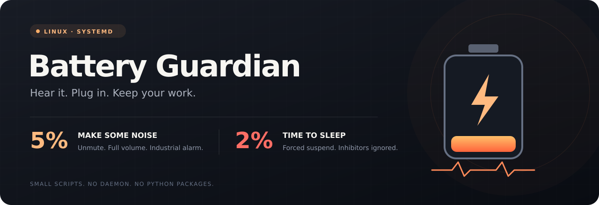

<p align="center">
  
</p>

<p align="center">
  <a href="https://github.com/nez/battery-guardian/actions/workflows/tests.yml"></a>
  <a href="LICENSE"></a>
  
  
</p>

<p align="center">
  <strong>A muted laptop should still tell you it's about to die.</strong><br>
  A loud battery alarm and a last-resort suspend, powered by small Python scripts and systemd timers.
</p>

<p align="center">
  <a href="#install">Install</a> · <a href="#what-happens">How it works</a> · <a href="#listen-first">Hear the alarm</a> · <a href="#uninstall">Uninstall</a>
</p>

## What happens

| Battery, while discharging | Action |
| :--- | :--- |
| **5% or below** | Unmutes the default audio output, sets it to **100%**, plays three industrial alarm bursts and sends a critical desktop notification. |
| **2% or below** | Requests **forced suspend**, bypassing software sleep inhibitors. |
| **Charging or full** | Neither action runs. The alarm resets for the next discharge. |

The alarm plays once per low-battery episode. It also resets when the battery rises above 5%. The suspend guard runs separately as root, so it can work even when nobody is logged in or the audio service fails.

> [!WARNING]
> **The 2% action deliberately ignores sleep blockers**, including those from running jobs, robot software or other applications. Suspend pauses those processes. Review this behavior before installing on a machine that controls hardware.

## Requirements

- Linux with **systemd** and **Python 3.8+**.
- One laptop battery exposed as `/sys/class/power_supply/BAT*`.
- A desktop audio session with `pactl` and `paplay`: PulseAudio, or PipeWire with PulseAudio compatibility.
- `notify-send` and administrator access through `sudo`.

The original setup was checked on **Ubuntu 24.04 with GNOME**. Other desktops and distributions need the same tools; they have not been verified on real hardware.

On Ubuntu / Debian, install the command-line dependencies:

```bash
sudo apt install python3 pulseaudio-utils libnotify-bin
```

## Install

Clone and review the scripts, then run the installer **as your normal desktop user**:

```bash
git clone https://github.com/nez/battery-guardian.git
cd battery-guardian
./install.sh
```

The installer asks for `sudo` to install the root-owned suspend guard. It generates the alarm sound locally, installs both timers and enables them immediately. Running it again updates the installed files.

**There is no pip install, background Python loop, network request or downloaded audio.** The four-second buzzer is synthesized with Python's standard library.

### Timing

| Check | Interval | Runs as |
| :--- | :--- | :--- |
| Audible warning | 30 seconds, plus scheduler delay | Your desktop user |
| Critical suspend | 15 seconds, plus scheduler delay | Root |

These are polling intervals, so an action follows the next check after the reported battery crosses its threshold. The warning starts with your user systemd session; the suspend guard starts at boot. A sleeping computer is not woken to check its battery.

## Listen first

Generate and preview the **low, rough, pulsed industrial buzzer** before installing:

```bash
python3 src/make-siren.py
paplay src/siren.wav
```

This preview uses your current volume and mute settings. The real low-battery alarm unmutes the output and sets it to 100%.

## Check status

```bash
# Desktop alarm
systemctl --user status battery-alarm.timer
journalctl --user -u battery-alarm.service -n 20

# System-wide suspend guard
systemctl status battery-critical-suspend.timer
journalctl -u battery-critical-suspend.service -n 20
```

Both timers should be **enabled** and **active**. Battery or audio errors are reported in the journal; a failed sound attempt can retry at the next check.

### Pause the protection

```bash
systemctl --user stop battery-alarm.timer
sudo systemctl stop battery-critical-suspend.timer
```

Use `start` instead of `stop` to resume. Stopping a timer does not cancel an action already in progress. The timers remain enabled for the next login or boot; use `disable --now` to keep them off.

## Things to know

- **Audio follows your default output**, including headphones or Bluetooth. The volume stays at 100% and the output stays unmuted after an alarm; previous audio settings are not restored.
- **Suspend is not hibernation.** RAM still needs power. A battery that keeps draining during sleep can eventually lose the session. The kernel and hardware must support suspend for the request to succeed.
- **Resume with the charger connected.** If you wake the laptop while it is still discharging at 2% or below, the next check requests suspend again.
- **One battery is supported.** Missing or multiple `BAT*` batteries produce an error rather than guessing an aggregate charge level.
- **Existing power policies still apply.** Firmware or desktop power management may suspend, hibernate or shut down earlier. This project does not change those policies.
- **Thresholds are intentionally simple.** The 5% alarm and 2% suspend are constants in the two scripts. If you change them, run the tests, update their expectations and reinstall.
- **One desktop user owns the alarm.** The suspend guard is shared by the machine. Install and uninstall from that same user account.

## Uninstall

From your checkout, as the same desktop user that installed it:

```bash
./uninstall.sh
```

This stops both timers and their services, then removes the installed scripts, units, sound and runtime alarm marker. It leaves unrelated files and current audio settings alone.

## Under the hood

```text
/sys/class/power_supply/BAT*/
  ├── capacity + status → user timer   → unmute → 100% → buzzer
  └── capacity + status → root timer   → systemctl --check-inhibitors=no suspend
```

| Source | Purpose |
| :--- | :--- |
| [`src/battery-alarm`](src/battery-alarm) | Threshold checks, one-shot alarm state, audio and notification. |
| [`src/battery-critical-suspend.py`](src/battery-critical-suspend.py) | Independently checks the battery before requesting suspend. |
| [`src/make-siren.py`](src/make-siren.py) | Generates the WAV from scratch, with no audio libraries. |
| [`systemd/`](systemd/) | User alarm units and system suspend units. |
| [`tests/`](tests/) | Thresholds, charging, rearming, failures, sound generation and installation. |

Run the checks without playing audio or suspending your machine:

```bash
bash -n install.sh uninstall.sh
python3 -m unittest discover -s tests -v
```

---

<p align="center">
  <sub>Small enough to read. Loud enough to notice. <a href="LICENSE">MIT licensed.</a></sub>
</p>
